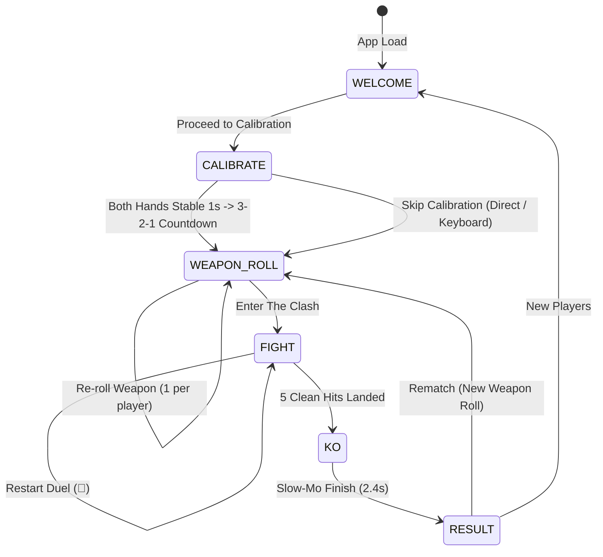

# ⚡ IEEE SB VIT Pune: Cyber Clash (Stickman Showdown)
## Claude Technical Architecture & Live Hand-Sign Combat Guide

> **Project Identity:** Official interactive tech fest and publicity booth exhibition game designed for the **IEEE Student Branch at Vishwakarma Institute of Technology (VIT), Pune**.  
> **Official IEEE SB VIT Pune Website:** [ieeesbvitpune.vercel.app](https://ieeesbvitpune.vercel.app/)  
> **Repository Type:** Zero-dependency, pure client-side Web Application (HTML5, Vanilla ES6+ JavaScript, Canvas 2D API, Vanilla CSS, Web Audio API, LocalStorage).  
> **Hosting & Deployment:** Vercel Static Web App (`vercel.json` rewrite rule to `index.html`).

---

## 1. Executive Summary & New Concept

**IEEE Cyber Clash** has been refactored from a scripted simulation into a **live, skill-based, 2-player fighting game controlled by HAND SIGNS through a single laptop webcam**.

- **Zero Scripted Outcomes:** Combat is 100% player skill-driven. Attacks only land if players are in spatial range and unblocked.
- **First to 5 Clean Hits Wins:** Instant match readability for booth spectators. 5 hit-pips per fighter on the HUD.
- **Real-Time Webcam Vision:** Powered by Google MediaPipe Tasks Vision `GestureRecognizer` (`numHands: 2`, GPU delegate with CPU fallback).
- **Offline Model Caching:** Cached locally in `/models/gesture_recognizer.task` (~8.3 MB).
- **Seamless Keyboard Fallback:** Full mirroring of all 6 actions for testing or poor booth lighting.

---

## 2. Hand Sign Controls & Mapping Table

Two challengers stand in front of ONE laptop webcam. The mirrored video feed is split into:
- **Left 50% ($X < 0.50$):** Player 1 (IEEE Blue)
- **Right 50% ($X \ge 0.50$):** Player 2 (IEEE Orange)

| Hand Sign | MediaPipe Label | In-Game Action | Execution Type | P1 Key | P2 Key |
| :--- | :--- | :--- | :--- | :--- | :--- |
| ✊ **Closed Fist** | `Closed_Fist` | **LIGHT ATTACK** (Quick jab/slash, fast recovery) | Edge-triggered | `A` | `J` / `Num 4` / `Enter` |
| ✌️ **Victory** | `Victory` | **HEAVY ATTACK** (Big overhead windup, breaks block, causes knockdown) | Edge-triggered | `S` | `K` / `Num 5` / `ShiftRight` |
| ✋ **Open Palm** | `Open_Palm` | **BLOCK GUARD** (Held guard, negates light hits, builds meter) | Held active | `D` | `L` / `Num 6` / `ArrowDown` |
| ☝️ **Pointing Up** | `Pointing_Up` | **MOVE FORWARD** (Step toward opponent) | Held active | `F` | `I` / `Num 8` / `ArrowRight` |
| 👍 **Thumbs Up** | `Thumb_Up` | **MOVE BACK** (Tactical retreat) | Held active | `G` | `O` / `Num 2` / `ArrowLeft` |
| 🤟 **I Love You** | `ILoveYou` | **SPECIAL OVERDRIVE** (Weapon super move, ignores block, needs 100% meter) | Edge-triggered | `H` | `P` / `Num 9` / `Slash` |
| 🖐️ **Hand Raised High** | Wrist $Y < 0.22$ | **HOP / DODGE** (Jump into air to avoid low sweeps) | Trigger | `W` / `Space` | `U` / `Num 0` / `ArrowUp` |

---

## 3. Repository File Directory & Responsibilities

| File | Primary Responsibility |
| :--- | :--- |
| [`index.html`](file:///d:/IEEE/Stick%20man%20game/index.html) | Single-page UI containing 5 screens (Welcome, Calibration, Roulette, Arena, Victory), modals, cheat-sheet HUDs, and PiP canvas. |
| [`hand-input.js`](file:///d:/IEEE/Stick%20man%20game/hand-input.js) | MediaPipe `GestureRecognizer` wrapper (video capture, mirroring, left/right zone partitioning, PiP neon skeleton drawing). |
| [`gestures.js`](file:///d:/IEEE/Stick%20man%20game/gestures.js) | Input engine: Debouncing, attack cooldowns, held movement/guard with 150ms grace period, lost tracking alerts, keyboard fallback, debug overlay (`[D]`). |
| [`stickman.js`](file:///d:/IEEE/Stick%20man%20game/stickman.js) | Procedural physics stickman: Damped spring rig, procedural walk cycle with foot-planting, spatial x-collision, lunge attacks, block guard, verlet ragdoll knockdown. |
| [`weapons.js`](file:///d:/IEEE/Stick%20man%20game/weapons.js) | 6 weapons, 18 sub-variants, 4 energy mods, 4 combat stances, 4 tech gadgets, 15 official VIT Pune academic departments, 2D canvas drawing routines. |
| [`arena.js`](file:///d:/IEEE/Stick%20man%20game/arena.js) | Canvas 2D arena: Hit-stop freeze frames (60-120ms), midpoint camera tracking, distance-based zoom, reactive crowd silhouettes, popups ("PERFECT BLOCK!"). |
| [`audio.js`](file:///d:/IEEE/Stick%20man%20game/audio.js) | Procedural Web Audio API sound synthesizer: Whoosh, roulette tick, heavy thud, parry clang, perfect block chime, KO sting, countdown beeps, crowd cheer. |
| [`leaderboard.js`](file:///d:/IEEE/Stick%20man%20game/leaderboard.js) | Tournament database: Clean hit scores, department standings, podium medals, inline match editor, mock duel generator, CSV export. |
| [`game.js`](file:///d:/IEEE/Stick%20man%20game/game.js) | Master state machine (`WELCOME` -> `CALIBRATE` -> `WEAPON_ROLL` -> `FIGHT` -> `KO` -> `RESULT`), slot machine animation, sudden death timer. |
| [`style.css`](file:///d:/IEEE/Stick%20man%20game/style.css) | Clean slate light theme, IEEE brand tokens (`--ieee-blue`, `--ieee-navy`), calibration split zones, roulette cards, 5 hit pips, PiP webcam. |
| `models/` | Houses local `gesture_recognizer.task` for 100% offline gameplay. |

---

## 4. State Machine & Gameplay Flow



---

## 5. Tunable Thresholds in `gestures.js` (`GESTURE_CONFIG`)

```javascript
const GESTURE_CONFIG = {
  DEBOUNCE_FRAMES: 2,         // Consecutive frames required to confirm a sign
  MIN_CONFIDENCE: 0.52,       // Minimum gesture recognizer confidence score (0.0 - 1.0)
  LIGHT_COOLDOWN_MS: 350,     // Cooldown after Light Attack before another can trigger
  HEAVY_COOLDOWN_MS: 1100,    // Cooldown after Heavy Attack
  SPECIAL_COOLDOWN_MS: 1800,  // Cooldown after Special Attack
  GRACE_PERIOD_MS: 150,       // Grace window for dropped frames on held actions
  LOST_TRACKING_WARN_MS: 1500,// Hand missing warning threshold (ms)
  LOST_TRACKING_PAUSE_MS: 5000,// Stalled duel pause threshold (ms)
  HOP_THRESHOLD_Y: 0.22       // Normalized wrist Y high in frame triggers a hop
};
```

---

## 6. Booth Setup Guide for Organizers

1. **Laptop Placement:** Place laptop on a table with webcam at chest/shoulder height (~1.1 to 1.3 m high).
2. **Player Stance:**
   - Both challengers stand or sit side-by-side **1.0 to 1.5 meters away** from the screen.
   - Player 1 stands on the **left side** of the laptop screen; Player 2 on the **right side**.
3. **Lighting & Environment:**
   - Ensure direct front lighting on players' hands; avoid strong bright backlights or open sunlit windows directly behind players.
   - A plain or uncluttered booth backdrop improves detection accuracy.
4. **Player Instructions:**
   - Keep hands open and palms angled toward the webcam when executing signs.
   - Use one dominant hand; do not cross the center screen line into the other player's zone.
   - Press **`[D]`** on the keyboard at any time to open the hidden real-time skeletal debug panel.
5. **Keyboard Backup Mode:** If lighting is harsh or camera permissions are blocked:
   - Player 1 uses `A/S/D/F/G/H`.
   - Player 2 uses `J/K/L/I/O/P` or Arrow keys / Numpad.

---

## 7. Known Limitations & Edge Cases

1. **Single Hand vs Dual Hands:** If a player raises both hands in their zone, the engine automatically selects the hand whose wrist is closest to their zone center ($X = 0.25$ or $X = 0.75$) and ignores the other.
2. **Camera Permissions:** Browsers require HTTPS (or `localhost`) to access `getUserMedia`. When deployed to Vercel, HTTPS is provided automatically.
3. **Lighting Shadows:** Dim booths may cause fist detection confidence to drop below 0.52; adjust `MIN_CONFIDENCE` in `gestures.js` if necessary.
