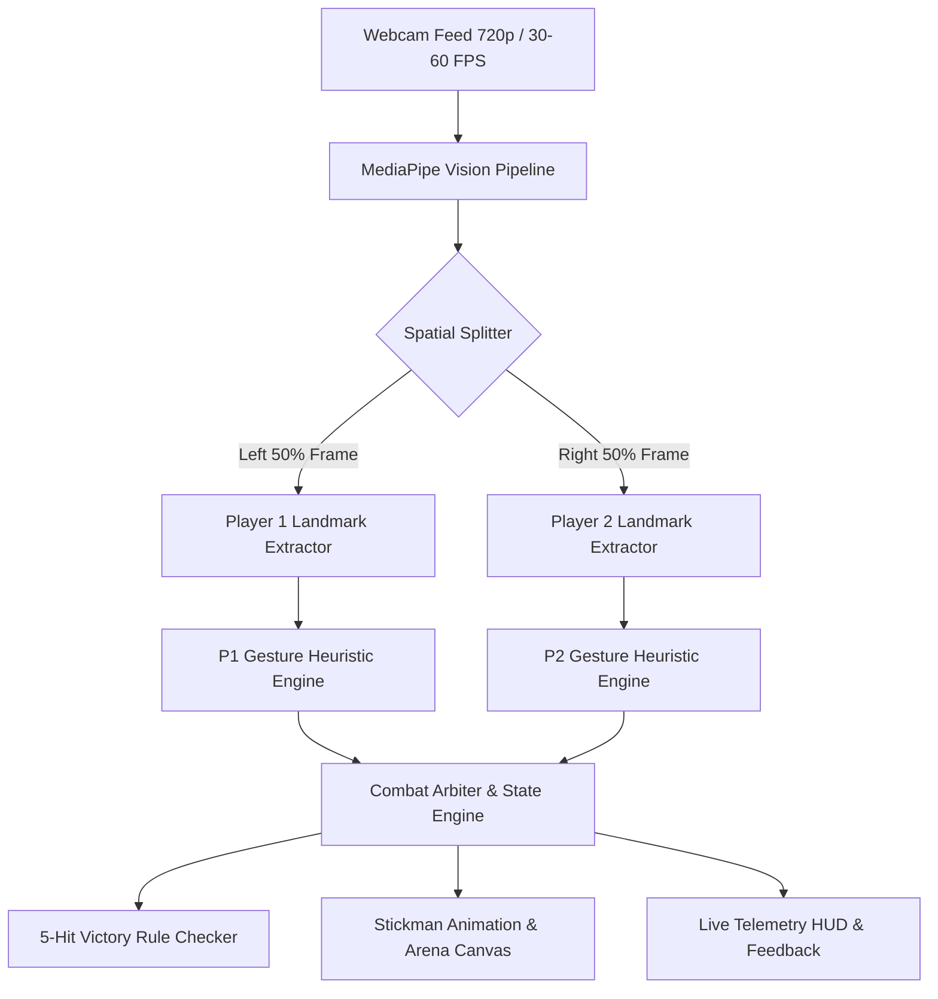
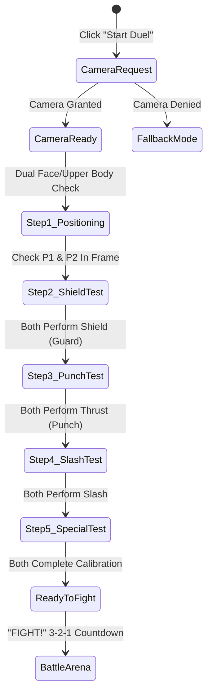
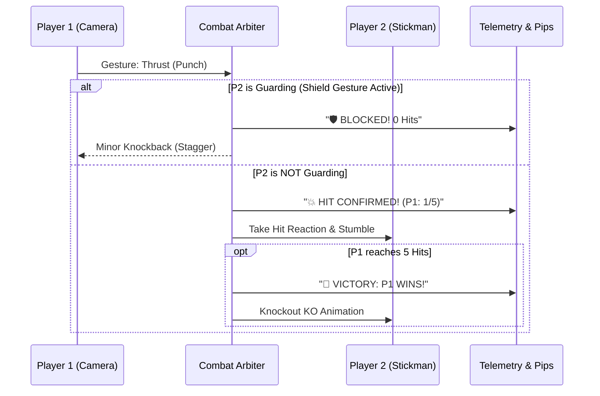

# Camera & Gesture-Based Combat Architecture
## IEEE Cyber Clash: Stickman Showdown • Dual-Player Motion Engine

---

## 1. Executive Overview

This document defines the system architecture, technology stack, interactive tutorial design, and integration roadmap for transforming **IEEE Cyber Clash** into a **real-time 2-player camera and gesture-controlled arena fighter**.

### Core Requirements
1. **Camera Integration**: Live single-webcam stream capturing two physical players simultaneously in front of the screen.
2. **Gesture Recognition**: Real-time recognition of **4–5 distinct offensive, defensive, and special gestures** per player.
3. **Face ID-Style Calibration Tutorial**: An interactive, guided onboarding sequence right after loadout selection that prompts each challenger to test and register their gestures before battle.
4. **5-Hit Victory Rule**: Fast-paced, tournament-ready combat rule where the **first challenger to land 5 unblocked hits wins the duel**.
5. **Robustness & Fallbacks**: Ultra-low latency (<35ms processing), clear HUD visual telemetry, and graceful keyboard/touch fallback if camera permissions are blocked.

---

## 2. Technology Stack & Evaluation

To ensure smooth 60 FPS performance without requiring high-end GPUs or native software installation, we evaluate three client-side Web vision engines:

| Criteria | **Google MediaPipe Tasks Vision** *(Recommended)* | **TensorFlow.js (MoveNet / HandPose)** | **Canvas Optical Motion Detection** |
| :--- | :--- | :--- | :--- |
| **Pipeline** | `PoseLandmarker` or `HandLandmarker` (WASM + WebGL) | `@tensorflow-models/pose` | Pure HTML5 Canvas Pixel Differencing |
| **FPS / Latency** | **45–60 FPS** (~18–25ms per frame) | 25–40 FPS (~35–50ms per frame) | 60 FPS (<5ms) |
| **Dual-Player** | Native multi-person tracking (`numPoses: 2` or `numHands: 4`) | Single or dual tracking (heavier bundle) | Zone bounding box only (no semantic gestures) |
| **Accuracy** | High precision 3D skeletal landmarks | Medium-High precision | Low (triggers on any motion) |
| **Bundle Size** | ~4.5 MB cached from CDN (Google CDN) | ~12 MB cached from CDN | 0 KB (vanilla JS) |
| **Decision** | **Primary Choice: MediaPipe Vision CDN** | Alternate fallback | Motion-energy hybrid booster |

### Recommended Stack Architecture
- **Vision Engine**: `@mediapipe/tasks-vision` via official Google CDN.
- **Spatial Partitioning**: Single webcam feed (1280×720 or 640×480) divided vertically:
  - **Left Half [0.0 to 0.5 X]** $\rightarrow$ **Player 1 (Challenger 1 / Rohan)**
  - **Right Half [0.5 to 1.0 X]** $\rightarrow$ **Player 2 (Challenger 2 / Tanvi)**
- **Recognition Layer**: Rule-based geometric heuristics computed over normalized skeletal landmarks (angles, vector velocity, and hand-to-body ratios) to guarantee zero neural-inference lag.



---

## 3. Spatial Camera Partitioning & Dual-Player Setup

In tournament or booth settings (e.g. IEEE SB VIT Pune campus events), two students stand side-by-side in front of the laptop/monitor webcam:

```
+---------------------------------------------------------------+
|                      WEBCAM VIEWPORT (16:9)                   |
|                                                               |
|   +-----------------------+   |   +-----------------------+   |
|   |                       |   |   |                       |   |
|   |      PLAYER 1         |   |   |      PLAYER 2         |   |
|   |    (CHALLENGER 1)     | : |   |    (CHALLENGER 2)     |   |
|   |                       | : |   |                       |   |
|   |   [P1 GESTURE ZONE]   |   |   |   [P2 GESTURE ZONE]   |   |
|   |                       |   |   |                       |   |
|   +-----------------------+   |   +-----------------------+   |
|         0.0 to 0.50 X                 0.50 to 1.00 X          |
+---------------------------------------------------------------+
```

1. **Mirror Mode**: The camera preview is horizontally flipped (`scaleX(-1)`) so player motion matches natural mirror intuition.
2. **Zone Guard**: Gestures initiated across the centerline ($X = 0.50$) are rejected to avoid crosstalk or accidental triggering.
3. **Bounding HUD**: A sleek, semi-transparent guide frame indicates where each player should position their upper body.

---

## 4. The 5 Core Combat Gestures

We define **5 intuitive, athletic gestures** that map directly to the fighting mechanics:

| Gesture Name | Physical Action | Landmark Heuristic | In-Game Combat Effect |
| :--- | :--- | :--- | :--- |
| **1. Fast Thrust / Punch** | Rapid punch forward directly toward camera with one fist | Wrist z-depth drops rapidly forward OR wrist extends rapidly outward horizontally away from shoulder | **Fast Attack**: Quick strike dealing 1 hit. Beats idle; interrupted by Shield. |
| **2. Heavy Cleave / Slash** | Arm raised above head and swung diagonally downward | Wrist passes above nose level then accelerates downward across chest | **Heavy Strike**: Sweeping weapon cleave. Breaks partial guard; slower startup. |
| **3. Kinetic Shield (Guard)** | Both forearms crossed in front of chest ("X") or open palm facing forward | Both wrists within 15% distance in front of sternum OR open palm stationary | **Block / Defense**: Completely negates incoming Fast Thrust; staggers attacker on perfect timing. |
| **4. Cyber Blast (Ultimate)** | Both arms thrust forward simultaneously (two open palms) | Both wrists rapidly pushed forward simultaneously within 50ms window | **Special Move**: High-speed particle projectile. High priority. |
| **5. Evasion / Side Lean** | Torso quickly tilts sideways or ducks down | Nose/shoulder midpoint shifts $>12\%$ laterally or vertically downward | **Dodge**: Completely avoids linear projectile / slash attacks. |

---

## 5. "Face ID-Style" Interactive Calibration Tutorial

Inspired by modern smartphone biometric enrollment (Apple Face ID / Google Face Unlock), before entering the live match, players enter the **Gesture Calibration Lab**.

### Tutorial UX Flow



### Tutorial Screen Elements
1. **Twin Calibration Orbs**:
   - Left side: Circular biometric radar for **Challenger 1**.
   - Right side: Circular biometric radar for **Challenger 2**.
2. **Progressive Step Checklist**:
   - Each gesture is demonstrated with an animated stickman vector graphic.
   - When Player 1 performs the required motion, their orb pulses **Cyan** and ticks **✓ P1 Complete**.
   - When Player 2 performs the required motion, their orb pulses **Purple** and ticks **✓ P2 Complete**.
   - Once both players pass the gesture, the system automatically advances to the next gesture.
3. **Skip Option**: A **"Skip to Match (Express Play)"** button is always present for experienced players or quick tournament turnarounds.

---

## 6. The 5-Hit Victory Rule & Combat Arbiter

Rather than standard health bars depleting continuously over 45 seconds, the match follows a crisp, high-stakes **First-to-5-Hits** ruleset:

### Hit Pipeline & Damage Logic


### Scoring Display (Hit Pips)
- Each player has **5 Cyber Energy Pips** on their HUD:
  - $\large \text{P1: } [\blacksquare][\blacksquare][\blacksquare][\blacksquare][\blacksquare]$ $\rightarrow$ Filled as hits land.
  - When a player lands their 5th hit $\rightarrow$ **SUPER SLOW-MO CLIMAX** triggers immediately, followed by the Victory Screen!
- **Match Duration**: A 45s round timer remains active as a sudden-death ceiling. If time runs out before 5 hits, the player with the most registered hits wins.

---

## 7. Implementation Roadmap & Phases

### Phase 1: Core Vision & Gesture Engine (`camera.js` & `gestures.js`)
- Integrate `@mediapipe/tasks-vision` via lightweight CDN script tags in `index.html`.
- Implement `GestureDetector` class to parse landmarks into `PUNCH`, `SLASH`, `SHIELD`, `SPECIAL`, and `DODGE`.
- Implement spatial left/right lane splitting.

### Phase 2: Interactive Calibration Tutorial Screen (`#screen-tutorial`)
- Build the **Biometric Enrollment UI** between Screen 2 (Loadout) and Screen 3 (Arena).
- Step-by-step gesture verification with audio feedback (`window.sounds.playSelect()`, `window.sounds.playClash()`).
- Responsive preview overlay with mirror mode.

### Phase 3: Combat Arbiter & 5-Hit System (`arena.js` & `stickman.js`)
- Wire gesture triggers to stickman actions (`fighter1.triggerAttack()`, `fighter2.triggerBlock()`).
- Replace % HP bars with the **5-Hit Pip Indicator** in the arena HUD.
- Implement hit detection resolution, blocks, staggers, and the 5th-hit KO climax.

### Phase 4: UI Polish & Spectator Telemetry
- Show real-time camera gesture badges over both player cards on the arena HUD.
- Add camera toggle (Show/Hide camera mini-pip in corner of arena).
- Keyboard fallback controls (`[W/A/S/D]` for P1, `[Arrow Keys]` for P2) if webcam is absent.

---

## 8. Summary Table of Architecture Deliverables

| Component | Target File | Description |
| :--- | :--- | :--- |
| **Vision Wrapper** | `camera.js` *(New)* | Webcam stream management, 60 FPS requestVideoFrameCallback, MediaPipe loader |
| **Gesture Classifier**| `gestures.js` *(New)*| Dual-lane heuristic calculator detecting the 5 core gestures with cooldown debouncing |
| **Tutorial UI** | `index.html`, `style.css` | Face ID-style circular biometric enrollment modal / screen with live checkmarks |
| **Combat Integration**| `game.js`, `arena.js` | 5-Hit First-to-Win game loop, hit arbitrations, and gesture HUD bindings |
| **Sound & Visual FX** | `audio.js`, `arena.js` | High-impact sound effects for confirmed hits, blocks, and 5-hit KO climax |
